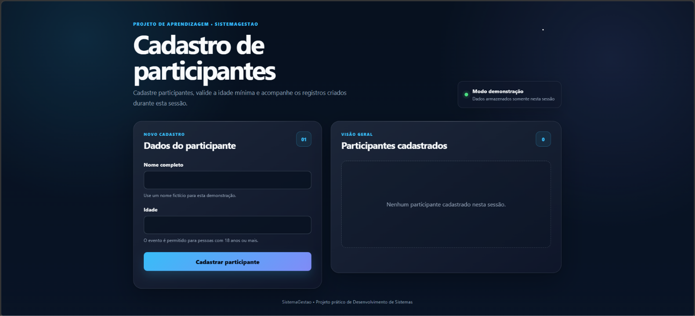

# SistemaGestao

Projeto integrador desenvolvido progressivamente para praticar **Desenvolvimento de Sistemas** com uma abordagem Full-stack.

Atualmente, o projeto reúne interface web, fundamentos de backend em C#, scripts SQL e automação com Python. Os módulos ainda são independentes e serão integrados gradualmente por meio de uma API.

## Demonstração

> A interface atual mantém os participantes somente na memória do navegador. Os dados são apagados quando a página é atualizada e ainda não existe integração com API ou banco de dados.

## Objetivo

Evoluir o projeto até formar um sistema de gestão completo, conectando interface, backend, banco de dados, automações, testes e implantação.

## Funcionalidades atuais

### Front-end

- Interface responsiva para cadastro de participantes
- Identidade visual em formato de painel administrativo
- Formulário com labels, textos auxiliares e foco visível
- Validações nativas do HTML e normalização do nome com `trim()`
- Mensagens visuais de aprovação e reprovação
- Lista temporária de participantes aprovados
- Contador atualizado dinamicamente com JavaScript
- Estado mantido somente na memória do navegador

### C# e regras de negócio

- Aplicação de console para cadastro de participantes
- Validação segura da idade com `int.TryParse`
- Regra de participação encapsulada em `PodeParticipar()`
- Inicialização do objeto por construtor
- Propriedades protegidas com `private set`

### SQL e banco de dados

- Tabelas de clientes e participantes
- Operações CRUD e consultas por ID
- Filtros, ordenação, aliases e classificação com `CASE WHEN`
- Contagens e funções de agregação
- Análise de qualidade com `DISTINCT`, `GROUP BY` e `HAVING`

### Python e automação

- Processamento de participantes com listas e dicionários
- Classificação por idade
- Geração de relatório em arquivo texto
- Total de participantes e taxa de aprovação

### Git e documentação

- Histórico incremental de commits
- Revisão seletiva antes das publicações
- Documentação da evolução e dos próximos passos

Todos os dados utilizados nas demonstrações são fictícios.

## Estrutura do projeto

| Pasta | Conteúdo |
| --- | --- |
| `frontend-js/` | Interface construída com HTML, CSS e JavaScript |
| `backend-csharp/` | Aplicação de console e fundamentos de backend em C# |
| `database/` | Scripts e exercícios de banco de dados SQL |
| `automation-python/` | Scripts de automação e processamento de dados |
| `docs/` | Trilha de aprendizagem, imagens e documentação das sessões |

## Como executar

### Interface web

Abra o arquivo:

`frontend-js/index.html`

### Aplicação em C#

~~~powershell
dotnet run --project backend-csharp/SistemaGestao.Console
~~~

### Automação em Python

~~~powershell
python automation-python/resumo_participantes.py
~~~

### Banco de dados

Abra os scripts no MySQL Workbench e execute somente os comandos que deseja estudar ou testar:

- `database/01_fundamentos_crud_clientes.sql` — fundamentos e consultas de clientes;
- `database/02_participantes.sql` — tabela, inserções e consultas de participantes;
- `database/03_qualidade_dados_participantes.sql` — consultas com `DISTINCT`, `GROUP BY`, `COUNT` e `HAVING`.

## Limitações atuais

- Os participantes da interface são mantidos somente na memória do navegador
- O Front-end ainda não consome uma API
- A aplicação C# ainda não está conectada ao MySQL
- Os scripts Python e SQL são executados separadamente
- Ainda não existem autenticação, testes automatizados ou implantação online

## Próximos passos

- Criar uma API para participantes
- Persistir os participantes no banco de dados
- Conectar o Front-end à API
- Implementar operações completas de cadastro, consulta, edição e exclusão
- Adicionar testes automatizados
- Publicar uma demonstração online
- Estudar Docker e CI/CD depois que a aplicação estiver integrada localmente

## Aprendizados aplicados

`HTML` • `CSS` • `JavaScript` • `C#` • `.NET` • `SQL` • `Python` • `Git` • `GitHub`

## Autor

**Pedro Porto**

[LinkedIn](https://www.linkedin.com/in/pedroporto-dev/) • [GitHub](https://github.com/PedroPorto021)